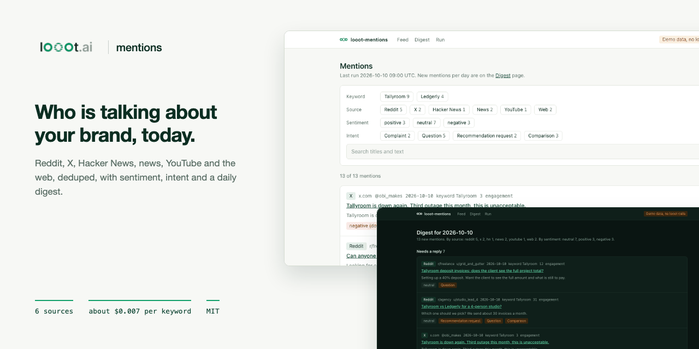
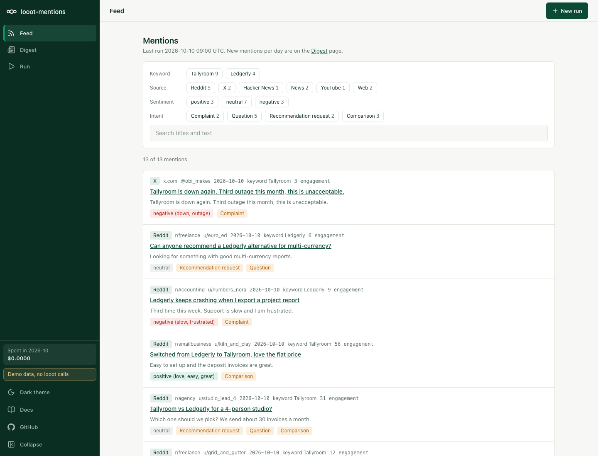
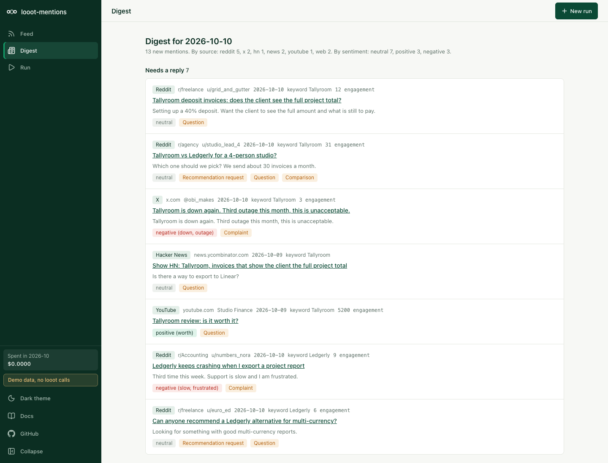
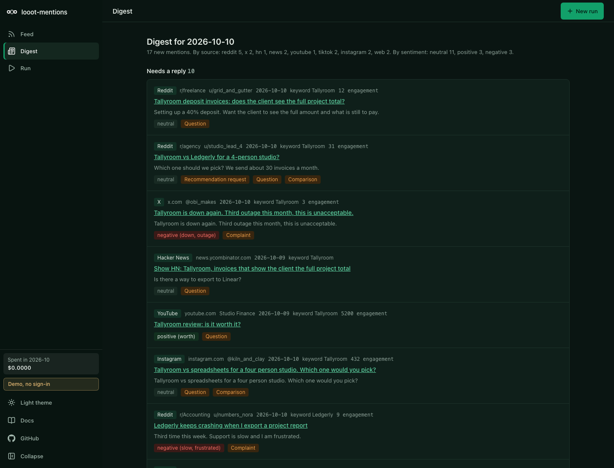

<p align="center"></p>

# looot-mentions

[](LICENSE) [](https://github.com/loootai/looot-mentions/releases) [](https://docs.looot.ai)

Brand and keyword listening in the open. Give it keywords and brand names. It searches Reddit, X, Hacker News, news, YouTube and the web through [looot](https://looot.ai), removes duplicates, tags each mention by source, sentiment and intent, and shows a feed with filters and a daily digest. A headless CLI writes only what is new since the last run to markdown, so it runs from a daily GitHub Actions cron.

An open-source alternative to Brand24 and Mention. On 2026-10-10 Brand24 listed $249 a month for its Individual plan ($199 billed yearly). Mention's pricing page showed no figure. Here one keyword on all six sources costs about $0.0066 per run, so 3 keywords daily is about $0.60 a month.



| Light | Dark |
| --- | --- |
|  |  |

## What it does

- Searches 6 sources per keyword and keeps a mention only when it contains the keyword and none of your exclusion words.
- Dedupes by canonical URL and by normalised title, so a story syndicated under ten URLs counts once and a link with tracking parameters matches the clean one.
- Tags sentiment (positive, neutral, negative) with word lists and shows the words that produced the label. Tags intent (complaint, question, recommendation request, comparison) with patterns. Both lists live in [config/rules.json](config/rules.json) and you can edit them.
- Feed with filters for keyword, source, sentiment and intent, plus text search.
- Daily digest, grouped as "Needs a reply" (complaints, questions, recommendation requests), comparisons and everything else, with the sources that did not answer listed at the bottom.
- Shows the list-price cost before any paid action, enforces a cap per run and a cap per month.

## Sources

| Source | looot job | Endpoint | List price per call |
| --- | --- | --- | --- |
| Reddit | `reddit.post.search` | `scrapecreators-reddit-search` | $0.00188 |
| X | `x.post.search` | `anyapi-run-twitter-search` | $0.00075 |
| Hacker News | `google.serp.organic` | `serper-search` with `site:news.ycombinator.com` | $0.0010 |
| News | `news.search` | `serper-news` | $0.0010 |
| YouTube | `youtube.search.videos` | `tikhub-api-youtube-web-search-video` | $0.0010 |
| Web | `google.serp.organic` | `serper-search`, excluding the sites above | $0.0010 |

looot has no Hacker News provider, so Hacker News is a Google search limited to that site. It finds stories and discussions that Google indexed, not every comment.

Prices are list prices read from the free public catalog on 2026-10-10. A real run re-reads them first and refuses to call an endpoint whose live price it cannot read.

Cost of a typical run, one keyword on all six sources at list price: $0.00663. Two keywords: $0.0133. A daily run of 3 keywords costs about $0.0199 a day.

Dropped, because looot has no provider for it: Facebook and Instagram posts by keyword, TikTok keyword search (providers exist, not wired here), podcasts, forums outside Reddit and Hacker News, review sites as a source, share of voice, influence scores and alerts on volume spikes.

## What you need

- Node 22.13 or newer. The GitHub Actions workflow uses Node 22 and the checks below ran on Node 24.18. The repo has no `engines` field or `.nvmrc`; the floor comes from the dependencies (Next.js 16 needs 20.9, Vitest 5 needs 22.12, ESLint 10 needs 22.13 on the 22 line).
- npm, which comes with Node.
- For the demo and for `--dry-run`, nothing else. No account, no token, no network.
- For a real run, a looot account and an agent token.
  1. Sign up at https://looot.ai/auth/sign-up.
  2. Get a token. Run `npm i -g looot` then `looot login`, which opens a browser approval. Or open the looot web app, go to Settings, "Agent tokens" and create one. See https://docs.looot.ai/get-started/sign-in.
  3. With no browser (CI, a server), create the token in Settings, "Agent tokens", then `export LOOOT_TOKEN=...`.
  4. The token needs the scopes `runs.execute`, `catalog.read`, `runs.read` and `usage.read`.
  5. A run needs a funded balance. The minimum top-up is $5, and signing up adds no credit. See https://docs.looot.ai/money.
- No Supabase, LLM key or other account. This repo does not use them.

## Try it in one minute

```bash
git clone https://github.com/loootai/looot-mentions.git
cd looot-mentions
npm install --ignore-scripts
npm run demo
```

Open http://localhost:3232. It shows sample data for invented brands, makes no looot call and needs no token. Stop it with Ctrl+C. The page answers HTTP 200.

The same sample data from the command line. The output paths keep the demo files out of your real data.

```bash
npm run mentions -- --demo --out digests-demo --data data/demo.json
```

## Run it with your own data

The CLI reads the token from the shell environment. It does not load `.env.local`. For the web UI (`npm run dev`), Next.js loads `.env.local` for you.

```bash
cp .env.example .env.local        # web UI only. For the CLI, export the variables instead.
cp mentions.example.yaml mentions.yaml
```

Edit `mentions.yaml`: your brand and competitors as `keywords`, plus the optional `exclude` words, `sources`, `maxSpendPerRunUsd`, `monthlyCapUsd` and `maxAgeDays`. The file ships with invented names (Tallyroom, Ledgerly).

Every environment variable the code reads:

| Name | Required | What it does | Where to get it |
| --- | --- | --- | --- |
| `LOOOT_TOKEN` | For a real run, CLI or web UI. Not for `--demo` or `--dry-run`. | Agent token sent as `Authorization: Bearer`. | See "What you need". |
| `LOOOT_API_URL` | No | Overrides the looot API base URL. Default `https://api.looot.ai`. | Leave unset. |
| `MENTIONS_DATA` | No | File the web UI reads and writes. Default `data/mentions.json`. The CLI uses `--data` instead. | Your choice. |
| `NEXT_PUBLIC_DEMO` | No | `1` switches the web UI to sample data. `npm run demo` sets it. | Set by the script. |
| `GITHUB_STEP_SUMMARY` | No | Set by GitHub Actions. The CLI appends the digest to it. | Set by GitHub. |

Price the run first. This reads the free public catalog for live prices when it can and falls back to the list prices in the code. It needs no token and makes no paid call:

```
$ npm run mentions -- --config mentions.yaml --dry-run
Plan: 2 keyword(s) on 6 source(s), 12 calls, list price $0.01326 (list prices dated 2026-10-10). Cap $0.2500 a run, $5.00 a month.
    2 x scrapecreators-reddit-search  $0.00188
    2 x anyapi-run-twitter-search  $0.00075
    4 x serper-search  $0.0010
    2 x serper-news  $0.0010
    2 x tikhub-api-youtube-web-search-video  $0.0010
Dry run: no looot call was made and nothing was written.
```

Then the real run:

```bash
export LOOOT_TOKEN=...
npm run mentions -- --config mentions.yaml
```

Options: `--keywords "Acme,Acme Pro"` instead of a config file, `--sources reddit,news`, `--out digests`, `--data data/mentions.json`, `--rules config/rules.json`, `--max-spend <usd>`.

Results go to two places. `digests/YYYY-MM-DD.md` holds the new mentions, and a second run on the same day appends to it. `data/mentions.json` holds every mention seen and the spend per month. `data/` is gitignored; `digests/` is not.

Web UI on your data: `npm run dev`, then open http://localhost:3000. It reads `data/mentions.json`. The Run page asks for a quote first (free), then searches for up to the quoted amount. There is no sign-in. Put the UI behind your own auth if you host it.

## Spending

- Every paid action shows a quote first. The CLI quotes with `--dry-run` and prints the same plan before a real run. The Run page shows the quote before its search button appears.
- The run cap is `--max-spend` or `maxSpendPerRunUsd` in the config. The default is $0.25. A call that would pass the cap is skipped and never sent.
- The month cap is `monthlyCapUsd`. The default is $5. The CLI checks it before the run starts, from the spend recorded in `data/mentions.json`, and stops with exit code 3 if the plan would pass it.
- A typical run is one keyword on all six sources at list price, $0.00663. Two keywords cost $0.0133. Three keywords daily cost about $0.0199 a day, about $0.60 a month.
- Each call carries an idempotency key made from the keyword, the call input, the endpoint and the day. A second run on the same day replays the stored run and charges nothing more.
- A call still going when waiting stops (60 seconds) is "pending", not "failed", and the digest says so.
- Failed calls are not charged by looot.

## Deploy

This app has no Supabase and no `vercel.json`. The web UI stores its data in a local file, so Vercel's read-only, per-request filesystem is a poor fit. The supported hosted setup is the daily GitHub Actions run below. To host the UI, run it on a machine with a disk: `npm run build && npm start`, with `LOOOT_TOKEN` in the environment and your own auth in front.

### Daily run on GitHub Actions

[.github/workflows/mentions.yml](.github/workflows/mentions.yml) runs at 06:23 UTC every day, writes the digest, and commits `digests/` and `data/`.

1. Fork or copy this repo and commit your own `mentions.yaml`.
2. Add the repository secret `LOOOT_TOKEN` (Settings, Secrets and variables, Actions).
3. Optional: set the repository variable `MENTIONS_CONFIG` (same page, Variables tab) to use a config file other than `mentions.yaml`.
4. Run it once. Open the Actions tab, pick "mentions", click "Run workflow" and tick `dry_run` to see the cost. Or from a terminal, `gh workflow run mentions.yml -f dry_run=true`. Run it again with `dry_run` off for a real run.

Until the secret exists the job ends with a notice ("LOOOT_TOKEN is not set, so nothing ran.") and spends nothing. The workflow passes `actionlint` 1.7.12. The caps in the config file apply, so a run never passes `maxSpendPerRunUsd` and the job stops before any call when the month's spend would pass `monthlyCapUsd`.

## Troubleshooting

| What you see | What it means | What to do |
| --- | --- | --- |
| `LOOOT_TOKEN is not set. Create an agent token at https://looot.ai/settings, or use --demo or --dry-run.` | The CLI found no token in the environment. | `export LOOOT_TOKEN=...` in the same shell. A `.env.local` file is not read by the CLI. |
| `LOOOT_TOKEN is not set on the server.` (HTTP 503 from the Run page) | The web server started without the token. | Put `LOOOT_TOKEN` in `.env.local` and restart `npm run dev`. |
| `looot returned HTTP 401`, or the message looot sends back, in the digest under "Sources that did not answer" as `failed (...)` | The token is wrong, revoked or missing a scope. | Create a new token with the four scopes listed above. |
| `looot returned HTTP 402`, or the message looot sends back | The balance may be too low. The code shows whatever looot returns and does not interpret it. | Top up at https://docs.looot.ai/money (minimum $5), then run again. The idempotency key replays finished calls for free. |
| `failed (blocked)` or `failed (stopped)`, or the run's own error message | looot blocked or stopped the run. | Open the run in the looot web app and read the reason. |
| `still running at looot, not failed`, with `Still running when waiting stopped. Read run <runId> later.` | The provider took longer than 60 seconds. | Not a failure. Look the run up in looot by its id, or run again later. The same-day idempotency key returns the stored run. |
| `The live price could not be read.` | The catalog price for that endpoint was unreadable, so the call was skipped. | Run again later. |
| `The spend cap would be passed.` | The call was skipped because it would pass the run cap. | Raise `--max-spend` or `maxSpendPerRunUsd`. |
| `The monthly cap of $5.00 would be passed. Nothing ran. Raise monthlyCapUsd to continue.` (exit code 3) | This month's spend plus the plan passes the cap. | Raise `monthlyCapUsd` or wait for the next month. |
| A source shows 0 mentions and no error | The provider answered in a shape the parser does not recognise. The parsers do not raise an error for that; they return nothing. | Open an issue with the raw response (see below). |
| `Every call failed. See the digest for the errors.` | All calls in the run failed. | Read the errors in the digest. |
| `No config at <file>` | The path after `--config` does not exist. | Copy `mentions.example.yaml` and check the path. |

### How to file an issue

Open an issue at https://github.com/loootai/looot-mentions/issues with the run id (shown in the looot run list and in the "Read run <runId> later" line), the command you used, and the raw response body with secrets removed.

## Status

No paid looot run was made. The code and fixtures follow the endpoint descriptions in the looot catalog and the parsers of the sibling repo [looot-monitor](https://github.com/loootai/looot-monitor). The Reddit, X, news and Google parsers reuse shapes from that repo. The YouTube parser searches the response for a list of videos because the exact nesting is not documented, and it is built from a hand-written fixture, so expect to adjust field names after your first real run. In the code, Hacker News and Web are marked `shapeVerified: true` (they use the pinned `serper-search` shape) and Reddit, X, news and YouTube are `false`. If a parser fails on a real response, open an issue with the raw response.

Sentiment by word list misses sarcasm and reads "recommend a tool" as neutral on purpose. Treat labels as a first pass: the feed shows the matched words so you can check each one. The GitHub Actions workflow was linted but not run, because it needs a repository secret. All demo brands are invented.

## Install for agents

- Read [llms.txt](llms.txt).
- Claude Code skill: copy `skills/mentions` to `~/.claude/skills/mentions`. It prices the run, asks for a yes, runs the CLI and leads with what needs a reply.
- Requires an agent token in `LOOOT_TOKEN`. See [What you need](#what-you-need).

## Develop

```bash
npm test && npm run typecheck && npm run lint && npm run build
npm run leak-scan
git config core.hooksPath .githooks
```

## Licence

MIT, copyright looot.

## Related

Other open-source projects built on [looot](https://looot.ai):

- [looot-intent](https://github.com/loootai/looot-intent): account intent and buying-stage scoring (6sense)
- [looot-score](https://github.com/loootai/looot-score): lead and ICP fit scoring (MadKudu)
- [looot-reveal](https://github.com/loootai/looot-reveal): which companies visit your site (RB2B, Clearbit Reveal)
- [looot-techstack](https://github.com/loootai/looot-techstack): website technologies from several providers (BuiltWith, Wappalyzer)
- [looot-signals](https://github.com/loootai/looot-signals): hiring, funding and news triggers (TheirStack, Harmonic)
- [looot-lookalike](https://github.com/loootai/looot-lookalike): lookalike company search (Ocean.io)
- [looot-ads](https://github.com/loootai/looot-ads): competitor ad board (Foreplay)
- [looot-reviews](https://github.com/loootai/looot-reviews): review themes and weak spots (ReviewTrackers)
- [looot-battlecards](https://github.com/loootai/looot-battlecards): competitor battlecards (Klue, Crayon)
- [looot-warm-leads](https://github.com/loootai/looot-warm-leads): warm leads from LinkedIn intent signals (Gojiberry)
- [looot-crm](https://github.com/loootai/looot-crm): a small CRM with buying signals built in
- [looot-seo](https://github.com/loootai/looot-seo): self-hosted SEO workspace
- [looot-monitor](https://github.com/loootai/looot-monitor): brand and competitor monitoring with alerts
